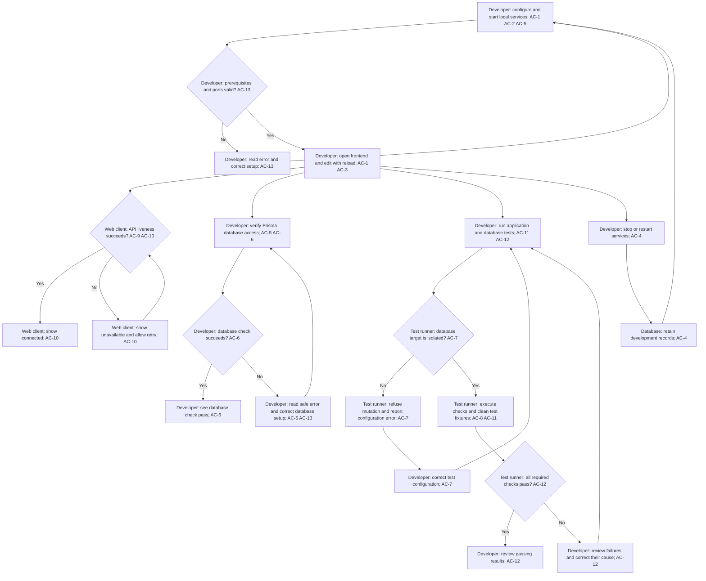

# Docker Prisma Foundation

## Overview

Give the project developer a repeatable local Docker environment for the existing React/Vite frontend and NestJS backend, with Prisma access to Supabase PostgreSQL, isolated development and test databases, and frontend tests using Jest and React Testing Library (RTL). The approved host ports are frontend 6789, backend 9876, development database 5554, and test database 5556. This extends the existing application foundation; it introduces no trading capabilities. Ticket: none. Scope approved by the user on 2026-10-18.

The existing implementation was inspected before scoping:

| Current behavior | Evidence | Existing automated coverage |
| --- | --- | --- |
| React/Vite development uses port 5173 and forwards `/api` to the backend | `apps/web/vite.config.ts:6`, `apps/web/vite.config.ts:15` | No frontend tests are configured in `apps/web/package.json:6` |
| NestJS defaults to port 3000 and the browser origin `http://localhost:5173` | `apps/api/src/config/environment.ts:2`, `apps/api/src/config/environment.ts:11` | HTTP tests assert the configured origin, not a fixed default port |
| Public `/api/health` returns process liveness; `/health` is absent | `apps/api/src/health/health.controller.ts:3`, `apps/api/src/configure-app.ts:7`, `docs/openapi.yaml:9` | Contract, route prefix, and CORS cases in `apps/api/test/app.e2e-spec.ts:23` |
| The connection screen checks liveness, waits at most five seconds, supports retry, and cancels obsolete requests | `apps/web/src/App.tsx:16`, `apps/web/src/App.tsx:70` | No existing automated frontend coverage |
| API tests use Vitest; the application has no persistence module | `apps/api/package.json:18`, `apps/api/src/app.module.ts:7` | Existing tests exercise local NestJS HTTP, not a database |

These are inspected implementation and test definitions, not newly executed verification results. The repository contains no Docker, Prisma, Supabase, or web test setup. The PRD's section 8.1 recommends Docker, PostgreSQL, Prisma, and Jest; this feature establishes local infrastructure without claiming completion of a product functional requirement or release phase.

## Goals

1. Start and stop both applications and the local databases through a documented Docker workflow using the approved host ports.
2. Support source reload and retain development records across normal shutdown, restart, and container rebuild.
3. Establish server-side Prisma database access with an observable connectivity check and a documented schema/client workflow.
4. Prove existing frontend behavior with Jest and RTL, and prove Prisma database operations against a disposable, isolated test database.
5. Preserve the current liveness contract and distinguish process availability from database availability.

## Core User Flow

1. The developer prepares the documented local prerequisites and configuration, supplying database credentials through the server/test environment. Dependency installation, migration application, and generated-client steps follow the existing repository gates; the user performs those steps unless later authorization changes that responsibility. This workflow controls only the developer's local environment. (AC-5, AC-13)
2. The developer starts the Docker environment. Both applications and the databases become available at the specified host ports. Missing prerequisites, invalid configuration, or occupied ports produce an actionable error; the developer corrects the cause and retries without an implicit data reset or alternate port. (AC-1, AC-2, AC-4, AC-13)
3. The developer opens the frontend at `http://localhost:6789`. The browser checks the backend through `/api/health` and shows checking, connected, or unavailable. A failed or timed-out check permits manual retry. Liveness success does not assert database availability. The developer can edit host source files and observe app reload. (AC-1, AC-3, AC-9, AC-10)
4. The developer separately verifies Prisma access to the local development database. The check reports success or a bounded, credential-free configuration/connectivity failure. After correction, the developer can retry the check. The browser receives no database credentials or direct database authority. (AC-5, AC-6, AC-13)
5. The developer runs the documented frontend and API checks and the separately identified database integration suite. Frontend tests control requests and time; existing API tests retain Vitest. Before database mutation, the database test runner validates that the target is the designated isolated test database. An absent or unsafe target produces a failure without mutation; the developer corrects the configuration before rerunning. (AC-7, AC-11, AC-12)
6. With a valid test target, the database test runner prepares its own test state, exercises Prisma reads and writes, and cleans its fixtures. It cannot modify development or shared data. Each required suite reports its actual passing or failing result, and a missing required suite cannot count as passing. After correcting failures, the developer can repeat the checks from independent test state. (AC-7, AC-8, AC-11, AC-12)
7. The developer stops or restarts the local services. Development records remain available on the next start, including after a container rebuild; test initialization and cleanup affect only the test database. (AC-4, AC-7)

## Workflow

The flow describes the developer's available actions, not a requirement that frontend or existing API tests wait for a database. Database target validation gates every database mutation, including setup and cleanup. An unsafe target does not prevent independent, database-free checks from running.

## Features

### Local development environment

- Docker startup and shutdown for both applications and separate Supabase PostgreSQL development/test instances. Published services are local to the developer's machine. (AC-1, AC-2, AC-13)
- Frontend/backend communication through the existing API path, with updated local ports and configured browser origin. (AC-1, AC-9)
- Host source reload and persistent development records during normal service lifecycle operations. (AC-3, AC-4)
- Documented prerequisites, configuration, startup, shutdown, and failure recovery without silently changing requested ports. (AC-1, AC-13)

| Service | Host address | Purpose |
| --- | --- | --- |
| Frontend | `http://localhost:6789` | Developer's browser application |
| Backend | `http://localhost:9876` | Local API, including `/api/health` |
| Development database | `localhost:5554` | Supabase PostgreSQL development records |
| Test database | `localhost:5556` | Separate Supabase PostgreSQL instance for disposable test state |

Ports 5554 and 5556 are PostgreSQL connection ports, not Supabase API or Studio ports. The approved architecture refinement adds migration-only `trading_shadow` on the development instance at the existing host port 5554. It is disposable migration scratch space, separate from both application data and `trading_test`; no extra host port is introduced.

### Prisma and database lifecycle

- Backend Prisma access, a documented schema/migration and client-generation workflow, and a separate database verification result. (AC-5, AC-6)
- Database credentials originate in developer-supplied server/test configuration and remain outside browser code, browser-visible configuration, and diagnostic output. (AC-13)
- Development records originate in local application/developer operations. Test records originate only in controlled test fixtures and are disposable; this feature defines no trading records. (AC-4, AC-5, AC-7, AC-8)
- Test target validation and isolated setup/cleanup protect development and shared data. (AC-7, AC-8)
- Architecture review refinements approved on 2026-10-18: a dedicated shadow database with target validation; 64-character hexadecimal administrator passwords for the pinned image bootstrap; safe quoted application-password handling; and one overall five-second database diagnostic deadline including cleanup. (AC-5, AC-6, AC-13)
- Development preservation is verified by a developer-run before/after sentinel outside the isolated database runner, which receives no development credentials. (AC-8)

### Automated checks and preserved behavior

- Existing public liveness contract and connection-screen behavior, with database availability assessed separately. (AC-6, AC-9, AC-10)
- Jest and React Testing Library frontend tests with controlled requests and time; the API retains its Vitest runner. (AC-11, AC-12)
- Real local Prisma database integration tests, separately identifiable from frontend and in-process API HTTP tests. (AC-8, AC-12)
- Clear test outcomes and documented commands; required missing tests or failed infrastructure cannot count as passing. (AC-12)

## Scope

### In Scope

- Local Docker development for the existing frontend and backend, source reload, the four approved host ports, and matching proxy/CORS configuration.
- Supabase PostgreSQL only, with separate development and test instances and durable development data.
- Prisma access in the backend, schema/client workflow documentation, and bounded database diagnostics.
- Jest and RTL frontend infrastructure and behavior tests, retaining existing Vitest API tests.
- Explicit local database test infrastructure and policy for safe, repeatable Prisma integration tests.
- Setup, operation, test, and troubleshooting documentation, plus API contract metadata updates needed for the backend address.
- Preservation of the current liveness contract, browser connection behavior, and repository server/domain boundaries.

Exact packages, versions, file placement, commands, database identity guards, and test-level assignments belong to `/architect`. The design must establish the missing test infrastructure before assigning evidence at those levels. Changes to user-managed `.ai/` rules still require approval; this overview does not silently rewrite the current rule files or authorize dependency installation, migration execution, or shared-service actions.

### Out of Scope

- Production Docker workflows, production deployment, hosted Supabase provisioning, and CI/CD setup.
- Supabase Auth, Storage, Realtime, Studio, and the full Supabase service stack.
- Trading schemas, product CRUD endpoints, authentication/ownership features, market providers, queues, and workers.
- Browser end-to-end test infrastructure and converting API tests from Vitest to Jest.
- Tests against hosted/shared databases, production resources, broker/news/market services, or credentialed external APIs.
- Changes to trading rules, live execution authorization, or deterministic domain calculations.

## User Roles

- **Developer/operator:** prepares configuration, starts/stops local services, edits source, checks connectivity, and runs tests. Controls only this local development environment and its records; production and shared resources are outside this feature.
- **Browser client:** requests public API liveness and displays transient checking/connected/unavailable state. May retry liveness; receives no database credentials, direct database access, or product execution authority.
- **Backend application:** serves the existing HTTP contract and owns server-side Prisma access to its configured local development database. Persistence remains outside deterministic domain calculations; no account or trading data interface is introduced.
- **Test runner:** controls deterministic test inputs and isolated test state. Frontend tests use controlled requests/time, existing API HTTP tests use the local NestJS application, and database tests may mutate only the validated test instance on host port 5556. It cannot mutate development, shared, or production data.

## Success Criteria

1. **AC-1** (change): A documented startup command runs the frontend and backend in Docker at host ports 6789 and 9876 respectively; frontend requests reach the backend through the existing `/api` path.
2. **AC-2** (change): Separate local Supabase PostgreSQL instances are reachable on host port 5554 for development and 5556 for tests. Published services bind to the local machine's loopback interface.
3. **AC-3** (change): Host source edits reload the corresponding frontend or backend application inside Docker.
4. **AC-4** (change): Normal shutdown, restart, and container rebuild preserve development database records.
5. **AC-5** (change): The backend uses Prisma for database access. Schema changes and client generation have documented workflows; no trading data model is introduced here.
6. **AC-6** (change): A developer can verify database access and receive a bounded, actionable failure when configuration or connectivity is wrong. Output omits credentials, and database verification remains distinct from process liveness.
7. **AC-7** (change): Database tests initialize and clean only the designated test database. Missing or unsafe targets, including development/shared targets, are rejected before any database mutation.
8. **AC-8** (change): Repeatable database integration tests demonstrate Prisma reads, writes, and cleanup against the test instance without changing development data.
9. **AC-9** (as-built): `/api/health` remains unauthenticated process liveness, returning HTTP 200 JSON `{ "status": "ok", "service": "trading-api" }`; `/health` remains absent with HTTP 404, and CORS follows the configured frontend origin. A successful liveness response is not a database readiness assertion.
10. **AC-10** (as-built): The connection screen preserves checking, connected, unavailable, manual retry, its five-second timeout, and cancellation of obsolete requests. Retry is disabled while checking; failed or invalid responses show unavailable.
11. **AC-11** (change): Jest and RTL tests cover those UI states, unsuccessful or malformed responses, network failure, timeout, retry, and cleanup using controlled requests and time.
12. **AC-12** (change): Documented checks run frontend Jest tests and existing API Vitest tests, with database tests identified separately. Failures and missing required tests cannot be reported as passing.
13. **AC-13** (change): Missing prerequisites, invalid configuration, and occupied ports produce actionable errors without silently choosing other ports. Retrying after correction preserves development data; database credentials remain server-side and out of diagnostic output.
