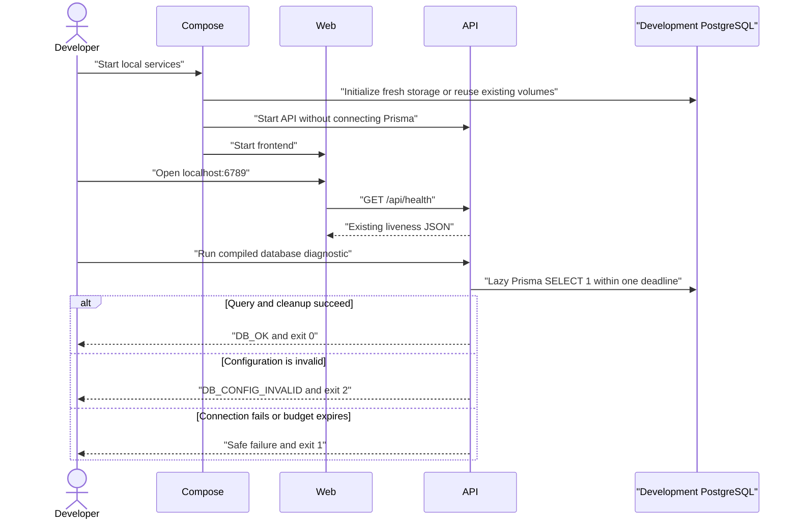
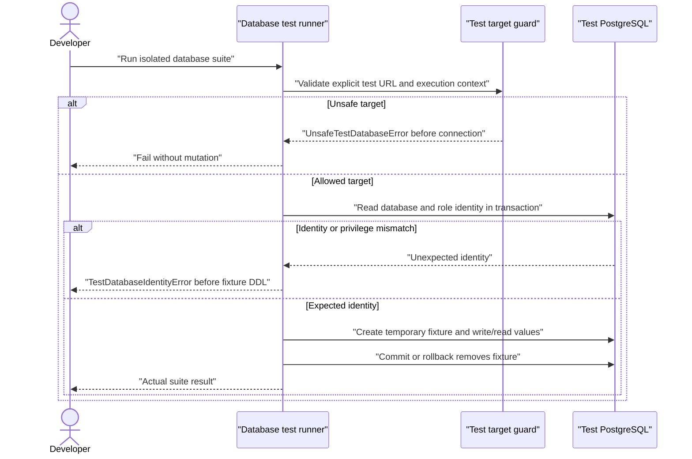

# Docker Prisma Foundation · System Design

## Summary

Build a local Docker Compose environment around the existing npm workspace, with frontend 6789, API 9876, development PostgreSQL 5554, and test PostgreSQL 5556.
Use separate Supabase PostgreSQL instances, a lazy server-side Prisma client, and a read-only database diagnostic with one five-second deadline.
Add Jest/RTL component coverage and a separately invoked, guarded Prisma database suite while retaining Vitest API tests.
Preserve process liveness, the existing connection screen, and development records across normal container lifecycle operations.
Approved on 2026-10-18 after repository inspection and an independent GPT-6 Astra design review; implementation has not started.

## Dependencies

### Existing foundations and reusable code

| Foundation or code | Evidence | Use |
| --- | --- | --- |
| npm workspace, root lockfile, pinned Node | `package.json:6`, `.node-version:1` | Keep the two applications and one dependency lock |
| Nest configuration | `apps/api/src/app.module.ts:8`, `apps/api/src/config/environment.ts:1` | Keep ConfigModule/ConfigService and port validation |
| Shutdown hooks | `apps/api/src/main.ts:13` | Close Prisma only if it was instantiated |
| Public process liveness | `apps/api/src/health/health.controller.ts:3`, `docs/openapi.yaml:9` | Preserve response and database independence |
| Real Nest HTTP tests | `apps/api/test/app.e2e-spec.ts:13` | Characterize root-module wiring, prefix, and CORS |
| API test discovery | `apps/api/vitest.config.ts:7`, `apps/api/vitest.config.e2e.ts:7` | Keep database specifications outside existing globs |
| Vite proxy and strict port | `apps/web/vite.config.ts:6`, `apps/web/vite.config.ts:17` | Update addresses and add Docker-specific host/watch settings |
| Connection effect and retry | `apps/web/src/App.tsx:16`, `apps/web/src/App.tsx:70` | Characterize before Docker wiring |
| React StrictMode | `apps/web/src/main.tsx:7` | Include obsolete-request and cleanup cases |
| Aggregate tests | `package.json:20` | Replace optional workspace discovery with explicit sequential levels |

Docker 29.8.1 and Compose 5.5.1 were found installed during planning. Their presence is not evidence that the proposed environment runs. No prerequisite product feature is missing.

### User-installed packages

Pin the following direct dependencies; the user performs installation and lockfile generation. No unrelated upgrades are planned.

| Task | Workspace and kind | Packages and reason |
| --- | --- | --- |
| 02 | Web dev dependencies | `jest@30.5.2`, `jest-environment-jsdom@30.5.2`, `@jest/globals@30.5.2`, `babel-jest@30.5.2`: runner, DOM environment, typed APIs, and transform |
| 02 | Web dev dependencies | `@babel/core@8.0.7`, `@babel/preset-env@8.0.7`, `@babel/preset-react@8.0.1`, `@babel/preset-typescript@8.0.7`: test-only TSX-to-CommonJS transform |
| 02 | Web dev dependencies | `@testing-library/react@16.3.3`, `@testing-library/dom@10.4.2`, `@testing-library/jest-dom@7.0.1`, `@testing-library/user-event@14.6.8`: behavior queries, matchers, and interactions |
| 03 | API runtime dependencies | `@prisma/client@7.10.1`, `@prisma/adapter-pg@7.10.1`, `pg@8.23.1`: generated client runtime and PostgreSQL driver |
| 03 | API dev dependencies | `prisma@7.10.1`, `@types/pg@8.23.1`, `dotenv@18.0.8`: CLI, driver types, and explicit CLI configuration loading |

Package metadata and engine/peer requirements were checked against Node 24.17.0 and the existing TypeScript/React versions. Prisma's unqualified CLI tag pointed to a release candidate during planning; use the explicit matching 7.10.1 versions. Installation, generation, build, and test evidence remain implementation work.

### Infrastructure, configuration, and schema gates

- Images: `node:24.17.0-bookworm-slim@sha256:862263c612aa437e3037674b85419622a9d93bff80aa1eee5398dfe686375532` and `supabase/postgres:17.6.1.136@sha256:f371b5f3f2ac0a05703f33d6e6134515fb2498cab708fb948a0aeb7481467c00`. Both are multi-platform manifests verified during planning.
- New root `.env.example` documents `DEV_DB_ADMIN_PASSWORD`, `TEST_DB_ADMIN_PASSWORD`, `DEV_DB_PASSWORD`, `TEST_DB_PASSWORD`, `DEV_DATABASE_URL`, `DEV_SHADOW_DATABASE_URL`, and `TEST_DATABASE_URL` with placeholders only. Administrator passwords are distinct 64-character hexadecimal values. Application passwords are quoted safely in SQL and percent-encoded in URLs.
- API environment examples retain `PORT` and `CORS_ORIGIN`, and add `DATABASE_URL` and `SHADOW_DATABASE_URL`. Web examples retain `API_PROXY_TARGET`; `DOCKER_WATCH` is a nonsecret container flag.
- Compose injects only development configuration into API and only test configuration into the test runner. Browser inputs contain neither database URLs nor credentials. Root private environment files are never mounted into either app.
- Prisma owns `apps/api/prisma/schema.prisma`, `apps/api/prisma7.config.ts`, and future `apps/api/prisma/migrations/`. This feature introduces no application model or migration. Bootstrap SQL provisions local databases/roles, not product entities.
- User-performed commands in API: `prisma:generate` runs `prisma generate --config prisma7.config.ts`; `prisma:validate` validates that schema; `prisma:migrate:dev` runs `prisma migrate dev --config prisma7.config.ts`; `prisma:migrate:deploy` applies approved migrations through the same config. No command is installed as an automatic startup hook.
- The migration command uses a config preflight mode derived from its Prisma CLI command arguments to require and validate both local development and shadow URLs before database work. It has no user-controlled bypass flag. Generation/validation may run without database credentials. The later migration-authoring workflow uses `--create-only --name <approved-name>`; the user applies reviewed migrations and regenerates the client. There is no initial migration to apply in this feature.
- Approved project-wide decisions and conditional test-role additions are recorded in the rule files separately from current implementation inventory.

Primary references: [Prisma 7 configuration](https://www.prisma.io/docs/orm/v7/reference/prisma-config-reference), [model-free generation in the pinned CLI](https://github.com/prisma/prisma/blob/7.10.1/packages/cli/src/Generate.ts), [Prisma shadow databases](https://www.prisma.io/docs/orm/v7/prisma-migrate/understanding-prisma-migrate/shadow-database), [pinned Supabase image](https://github.com/supabase/postgres/blob/17.6.1.136/Dockerfile-17), [pinned bootstrap](https://github.com/supabase/postgres/blob/17.6.1.136/migrations/db/migrate.sh), [Jest transforms](https://jestjs.io/docs/code-transformation), and [PostgreSQL SQL interpolation](https://www.postgresql.org/docs/17/app-psql.html).

## Boundaries

| Boundary | Owns | Excludes |
| --- | --- | --- |
| Compose and local PostgreSQL bootstrap | Local resources, credentials mapping, database identities, volumes, health checks | Application migrations, hosted services, product data |
| API database module | Lazy Prisma allocation, validated connection configuration, resource lifecycle | Domain calculations, authentication policy, eager startup connectivity |
| Database diagnostic command | One read-only check, safe result mapping, overall deadline | Public HTTP readiness endpoint, retries, writes |
| Web | Existing presentation and transient liveness state | ORM, database configuration, execution authority |
| Test harness | Deterministic requests/time and disposable local fixtures | Development credentials and shared resources |

Task 04 introduces the shared development image and one-shot database-test service because that infrastructure is needed before Task 06. Task 06 adds the API runtime service; Task 07 adds the web runtime service. No forward dependency on an unfinished task is permitted.

## Data Model

None: no persistent application entities or Prisma models are introduced.

| Resource | Owner and access | Retention |
| --- | --- | --- |
| `trading_dev` | Development instance; login `trading_dev` owns its application database/schema; no superuser, role-creation, or database-creation privilege | Persistent development volume |
| `trading_shadow` | Same development instance; login `trading_dev`; Prisma migration tooling only | Disposable migration scratch data; never used by app or tests |
| `trading_test` | Test instance; admin-owned database; login `trading_test` receives CONNECT and TEMP, without permanent schema creation or administrative privileges | Isolated test volume; no application records |
| Temporary `prisma_probe` | One guarded test transaction; `id text PRIMARY KEY`, `value text NOT NULL`; no relationships | `ON COMMIT DROP`; rollback removes creation and writes |

The developer's persistence/sentinel verification creates a uniquely named verification table and record in development, checks that same record after the relevant operation, and removes only that identified table afterward. It is a verification fixture, not an application model.

## API Surface

| Operation | Caller and authentication | Request | Response and errors |
| --- | --- | --- | --- |
| `GET /api/health` | Public browser/local caller; no authentication | No body; optional Origin header | Preserve 200 JSON `{ "status": "ok", "service": "trading-api" }` and configured CORS |
| `GET /health` | Local HTTP caller | No body | Preserve 404 |
| `npm run db:check --workspace @trading/api` | Local developer; compiled API and explicit server environment | Read-only `SELECT 1` through Prisma | Exit 0 + `DB_OK`; exit 2 + `DB_CONFIG_INVALID`; exit 1 + `DB_UNAVAILABLE` or `DB_TIMEOUT` |
| `npm run test:db` | Developer invoking isolated test runner | Explicit test target | Real suite result; unsafe target or connected identity fails before fixture writes |

No new HTTP endpoint, request DTO, authentication exception, pagination, or product response is added. Fixed diagnostic messages explain the corrective action without exposing the URL or raw driver error.

## Routes and Screens

The existing root screen remains unguarded because it displays only public process liveness. It requests the same-origin `/api/health` path. Preserve checking, connected, unavailable, retry disabled while checking, and the existing unavailable help. There is no empty data state or database-readiness display. Production preview/deployment is outside this work.

## Components and State

Retain the existing App component, `connection` and `attempt` state, request AbortController, active-request flag, and five-second browser timeout. No global state, cache, form, or reusable component layer is needed.

Task 02 characterizes the current component before Task 07 changes web runtime wiring. Use controlled fetch promises that reject on abort, explicit Jest imports, RTL DOM queries, fake time, and StrictMode cases. A separate test TypeScript project avoids leaking test globals into application code. Jest config supplies a test-only Babel transform, automatic React runtime, and CSS stub; it does not supply Vite's transform or introduce a shared Babel config.

## Public API and Compatibility

No shared TypeScript package or versioned public export is introduced. Keep the existing ESM/NodeNext API conventions and explicit injection/factory wiring because Vitest does not reproduce TypeScript decorator metadata automatically.

Use the `prisma-client` generator with explicit ESM output at `apps/api/src/generated/prisma`, TypeScript files, and `.js` import suffixes for the compiled API. Generated files are user-produced and excluded from Git, lint, and formatting; never hand-edit them. Generation must produce an empty-model client, and API build/typecheck must consume it successfully before the task can pass.

Root `npm test` becomes an explicit sequence: API source unit tests, API HTTP suite, web component suite. It removes `--if-present`, preserves failure exit status, and does not repeat the mixed API suite. Database tests remain separately invoked; feature verification runs them after the other levels.

## Access and Isolation

- Publish host ports on `127.0.0.1`. Services listen on appropriate container interfaces; internal PostgreSQL port is 5432.
- Keep development and test database credentials distinct. No application or test service receives database administrator credentials.
- Place API, web, and development DB on the application network. Place db-tests and test DB on a separate test network; the test runner has no development network attachment or Docker socket.
- The test harness reads only `TEST_DATABASE_URL`, never `DATABASE_URL`. Native mode permits `localhost` or `127.0.0.1`, port 5556, database/login `trading_test`. Docker mode permits only `db-test:5432` with the same database/login, selected explicitly by the test-service configuration.
- Permit only PostgreSQL URL schemes, one host, exact database/login, and an explicit allowed port. Reject URL query parameters, fragments, malformed encoding, and options that could override the parsed endpoint. Never allow an unsafe-target bypass.
- On the same transaction/connection used for fixtures, first read `current_database()`, `current_user`, and role privileges. Reject any identity mismatch or administrative privilege before DDL. Only then create temporary fixtures.
- Use one database test worker and no file parallelism. Each fixture is independent and uses parameterized values in static SQL.
- Migration preflight permits only the local development endpoint with `trading_dev` and the same endpoint/login with database `trading_shadow`. Reject alias-equivalent development/shadow identity, test port/database, remote endpoint, overrides, or missing shadow configuration. No automatic CREATEDB fallback.
- Existing API tests explicitly set test environment before application imports and configure ConfigModule to ignore environment files in test mode. Missing, invalid, and unreachable database configuration must not affect liveness.

## Async and Integrations

Only local PostgreSQL is integrated. Use `@prisma/adapter-pg` with a single lazily allocated client per API process; reuse it and disconnect on application shutdown if allocated. Constructors, module initialization, and liveness do not instantiate a pool, validate mandatory database credentials, or open a connection.

The diagnostic command starts one overall 5,000 ms deadline at its entry, before client creation. Validation, connection, query, and cleanup share that budget; individual driver timeouts use the remaining budget and cannot extend it. A watchdog emits a fixed timeout result and terminates only this diagnostic process if cleanup or network I/O stalls. No retry occurs automatically. Measure the compiled command against a stalled local TCP handshake, allowing only documented process-launch/scheduling tolerance outside the diagnostic budget.

No queue, worker, schedule, durable job, webhook, broker, hosted Supabase API, or external request simulation is needed.

## Pipelines and Data Quality

None: no ingestion or research pipeline is introduced. The only data-producing activities are local bootstrap, explicit future migrations, and test/manual verification fixtures. Tests control their values and ordering; no live data or production credential is used as a fixture.

## Resources and Rollout

### PostgreSQL bootstrap and storage

Use the pinned image's standard entrypoint and `postgres -c config_file=/etc/postgresql/postgresql.conf` command. Keep `POSTGRES_DB=postgres`, `PGDATABASE=postgres`, and PostgreSQL port 5432 for upstream initialization. Do not replace Supabase's initialization directory.

Each database service has two distinct named volumes: `db-dev-data` / `db-test-data` mounted at `/var/lib/postgresql/data`, and `db-dev-config` / `db-test-config` at `/etc/postgresql-custom`. No volume is shared across environments. The configuration volume preserves the image's custom configuration/key material.

Mount the appropriate project bootstrap SQL read-only at `/etc/postgresql.schema.sql`, the pinned migration script's post-initialization hook, executed as `supabase_admin`. Development SQL creates the limited development login and the development/shadow databases. Test SQL creates the restricted test login/database and revokes inherited privileges that would defeat its CONNECT/TEMP-only boundary.

A small shell entrypoint validates required inputs and the 64-hex administrator password before delegating to the upstream entrypoint. It never echoes passwords. Bootstrap obtains application passwords with psql `\getenv` and uses quoted literal interpolation, not shell-built SQL. Disable statement/error-statement logging around credential DDL and emit safe setup errors. Validate redaction with disposable synthetic inputs.

Initialization runs only for a fresh volume. Existing volumes retain data, roles, and stored passwords. Changing environment values does not rotate existing credentials; document explicit user-performed rotation/reconciliation. A bootstrap failure does not authorize automatic deletion or reinitialization of a volume.

### Application image and runtime

Task 04 creates the shared `Dockerfile.dev`, mandatory `.dockerignore`, and db-tests profile. Use explicit COPY paths for manifests and needed source/config/test files, Linux `npm ci`, and no private environment files, credential paths, host node_modules, dist, coverage, or transient artifacts. Do not put secrets in build arguments or layers.

The adopted ESLint setup also requires root `tooling/eslint/` and `eslint.config.mjs` alongside the application configs. Preserve those paths in the image so workspace lint commands remain usable. The root Makefile provides formatting and application-image recovery wrappers; its recovery helper never removes database volumes.

Root `test:db` runs `docker compose run --build --rm db-tests`. Inside that container, build the current API source before invoking its dedicated database suite; this provides compiled diagnostic entries while keeping host dist excluded. The build does not generate a client or apply migrations. Native execution has the same explicit build prerequisite. The image/source COPY layout must work before optional Task 02 web-test files exist.

Tasks 06/07 use that image for API/web. Bind only the source/test paths needed by the service; retain container-installed dependencies. Generate Prisma explicitly through the user-run one-shot API command before runtime startup, writing only its generated source path. A missing generated client produces an actionable setup failure; startup never generates or migrates implicitly.

Enable TypeScript file/directory polling for API Docker watch and Vite polling under `DOCKER_WATCH`. Native development retains its existing watch behavior. Rebuild after dependency/configuration changes.

### Commands and rollout

1. User installs pinned dependencies and prepares private local configuration from examples.
2. User starts the Task 01 database services and validates their identities and persistence.
3. User generates the Prisma client explicitly; database URLs are unnecessary for generation alone.
4. As infrastructure tasks land, run component and database suites independently.
5. Build the application image, generate in the selected runtime if necessary, and run `npm run docker:up`: `docker compose up --build --wait --wait-timeout 120`.
6. Normal shutdown is `npm run docker:down`: `docker compose down`, without volume removal. Default startup includes both databases and both apps; the one-shot db-tests service has a test profile.

Database health checks verify the intended application database/login, with bounded connection time. API health checks use process liveness; web health checks verify serving. API startup has no database-readiness dependency. Compose may report a partial startup failure while some services remain available; report actual state and retry after correcting the cause.

Local Docker consumes only developer machine resources. Downloads are needed for initial images/dependencies. No paid cloud resource, deployment, CI pipeline, or account connection is created. Rollback preserves database volumes and does not attempt unsupported database downgrades.

## Flows

## Failure and Edge Cases

| Trigger | Designed outcome and evidence |
| --- | --- |
| Missing Docker, daemon, image, configuration, or generated client | Actionable setup error; no alternate port or implicit reset |
| Occupied host port | Startup fails at the requested port; developer frees it and retries |
| Database configuration absent or invalid | Liveness still succeeds; diagnostic returns fixed configuration failure |
| Authentication failure, closed connection, or stalled server | Safe connection/timeout outcome within the overall diagnostic budget |
| Invalid test URL, development target, query override, or wrong server identity | Refuse before fixture mutation; never print supplied URL |
| Test assertion/transaction failure | Rollback removes temporary state; later tests start independently |
| Concurrent test invocations | Temporary tables are connection-local; each suite uses one worker; no shared persistent fixture |
| Missing required suite or failed child command | Nonzero aggregate result; do not hide failure with optional discovery |
| Restart, rebuild, or normal shutdown | Development records and matching configuration volumes survive |
| Credentials changed on an existing volume | Explain stored-credential mismatch and explicit rotation; no automatic reinitialization |
| Invalid, failed, timed-out, or obsolete health response | Preserve existing unavailable/cleanup behavior and manual retry |
| Shadow URL aliases development or test | Reject before migration work; no automatic shadow creation fallback |

## Security and Observability

Expose only local host interfaces. Keep passwords and URLs in private server/test configuration; examples contain placeholders. Do not read private files during agent inspection, print resolved Compose configuration, or log raw Prisma/pg errors. Validate Compose using its quiet mode.

The API diagnostic reports one fixed result and exit code. Bootstrap errors identify the failed stage without SQL containing credentials. No new metrics, alerts, rate limiting, or authentication system is needed for this local foundation.

Manual evidence records exact commands/actions, local environment, result, and cleanup, never secret values. The development sentinel check is performed by the developer outside the isolated runner; only its identified verification table may be removed.

## Value Sourcing

| Value | Source |
| --- | --- |
| Host ports 6789/9876/5554/5556 | Approved scope AC-1/AC-2 |
| Internal PostgreSQL port 5432 | Local resource design |
| Development/test/shadow names and logins | Accepted contracts and review refinement |
| Credentials and correctly encoded URLs | User-provided private environment; no embedded defaults |
| 64-hex administrator format | Pinned upstream bootstrap's SQL interpolation behavior |
| API PORT/CORS and web proxy | Approved addresses; service DNS inside Compose, localhost for native development |
| Browser status and 5,000 ms timeout | Existing App implementation |
| Diagnostic result, exit code, and 5,000 ms deadline | Accepted diagnostic contract and reviewed lifecycle clarification |
| Health response | Existing HealthController/OpenAPI |
| Runtime/package/image pins | Existing Node pin and public package/image metadata inspected during planning |
| Test identity facts | Read-only PostgreSQL identity/privilege query on the fixture connection |
| Temporary fixture values | Fixed test inputs |
| Development sentinel identity/value | Developer-created verification fixture recorded by its task |
| Startup wait limit of 120 seconds | Compose orchestration decision; failure does not change ports or delete storage |

## Decisions

| Decision | Reason | Runner-up |
| --- | --- | --- |
| Compose with database-only Supabase images | Matches approved local PostgreSQL scope | Full Supabase stack adds unrequested services |
| Separate instances, networks, credentials, and guarded test identity | Protect development state through independent controls | Separate schemas share more authority and failure modes |
| Pre-created development shadow database | Working migration workflow without CREATEDB or reuse of the test DB | Granting development CREATEDB expands privilege |
| Lazy Prisma provider and separate diagnostic | Preserve database-independent liveness and HTTP tests | Eager connect couples process availability to PostgreSQL |
| Model-free schema and transaction-local raw fixtures | Prove the requested foundation without inventing entities | Permanent probe model creates unnecessary application schema |
| Prisma 7.10.1 explicit matching pins | Compatible stable client/adapter/CLI combination | Unqualified CLI selected a release candidate |
| Jest with isolated Babel transform | Honors approved Jest/RTL choice alongside Vite | Vitest frontend was not the approved runner |
| Explicit generation, migrations, and dependency gates | Preserve repository ownership rules | Automatic startup mutation hides responsibilities |
| Sequential aggregate and separate DB suite | Preserve independent local checks and honest failures | Optional/mixed discovery obscures missing levels or ordering |
| Shared image introduced in Task 04 | Database tests can execute before API Docker wiring | Creating it in Task 06 creates a forward dependency |
| One diagnostic deadline including cleanup | Enforce the accepted bound under stalled I/O | Independent phase timeouts can accumulate |
| Developer-run development sentinel | Proves preservation without giving tests development access | Test runner with development credentials weakens isolation |

The independent review's six findings were accepted: shadow workflow, build exclusions, sequential test levels, concrete bootstrap/storage, overall diagnostic deadline, and external development sentinel evidence. No product scope changed.

## Test Strategy

Levels are API unit, API HTTP integration, web component (Task 02), and API database integration (Task 04). Task 01/06/07 also require running-environment evidence. New levels follow the approved conditional rule additions; unavailable infrastructure is not a pass.

| AC | Built by | API unit | API HTTP integration | Web component | API database integration | Local environment evidence |
| --- | --- | --- | --- | --- | --- | --- |
| AC-1 | 06, 07 | 06 · port/origin defaults and invalid port | 06 · liveness and configured CORS | none: transport boundary | none: no DB assertion | 07 · browser 6789 reaches API 9876 through proxy |
| AC-2 | 01 | none: container resource | none: not HTTP | none: not UI | 04 · expected test identity | 01 · both loopback bindings and distinct identities |
| AC-3 | 06, 07 | none: real filesystem watcher | none: does not prove reload | none: does not prove reload | none: not DB behavior | 06/07 · Windows host edits update each running app |
| AC-4 | 01 | none: real storage lifecycle | none: not HTTP | none: not UI | none: test suite has no development access | 01 · sentinel survives restart/recreation/rebuild; matching config volume retained |
| AC-5 | 03 | 03 · lazy allocation/reuse/closure and migration URL guards | 03 · module boots without DB access | none: server-only | 04 · real Prisma read/write operations | 03 · explicit model-free generation, validation, compiled import, and shadow identity |
| AC-6 | 05 | 05 · fixed result mapping, invalid config, cleanup, timeout budget | none: CLI only | none: CLI only | 05 · query success and compiled CLI stalled-handshake deadline | 05 · compiled CLI success/failure and safe output |
| AC-7 | 04 | none: harness-owned logic cases live in dedicated infrastructure suite | none: not HTTP | none: not UI | 04 · URL rejection and controlled identity-query rejection before mutation; real expected identity/privilege checks | 04 · test network and credential separation |
| AC-8 | 04 | none: requires real PostgreSQL | none: no persistence endpoint | none: not UI | 04 · round-trip, success/rollback cleanup, repeatability | 04 · developer's before/after development sentinel |
| AC-9 | 03, 06 | 03 · provider initialization performs no DB work | 03/06 · unchanged health/prefix/CORS with absent/invalid/unreachable DB | none: HTTP is owning level | none: liveness is database-free | 06 · liveness while database is unavailable |
| AC-10 | 02, protected by 07 | none: web owner | none: cannot prove screen | 02 · characterization; 07 · regression before/after wiring | none: no DB UI | 07 · browser retry/recovery through Docker |
| AC-11 | 02 | none: web owner | none: not HTTP contract | 02 · all response/error/time/retry/cleanup/StrictMode branches | none: requests controlled | none: component level owns these cases |
| AC-12 | 02, 04, 07 | 07 · source suite discovered separately | 07 · HTTP suite discovered separately | 02/07 · required component suite | 04 · separate required DB suite | 07 · aggregate ordering/failure propagation and no empty-suite success |
| AC-13 | 01, 03, 05, 06, 07 | 03/05/06 · safe configuration errors and redaction | 06 · valid origin configuration | none: deployment config is not screen state | 04/05 · safe target/diagnostic failures | 01/06/07 · missing setup, occupied ports, image exclusions, credential changes, and retry without data loss |

Run API unit → API HTTP → web component → API database integration, one process at a time. Each task owns the cases for its behavior; there are no standalone test-writing tasks beyond the two required infrastructure tasks. Task 02's characterization precedes web runtime changes. Task 03 extends real AppModule HTTP characterization before introducing its provider. Passing tests are not claimed until executed and recorded by the owning workflows.

The dedicated database suite contains both harness-logic cases and real PostgreSQL cases. Wrong identity or elevated privilege is supplied through controlled identity-query doubles to prove refusal before DDL; the restricted test login cannot create elevated roles. Real PostgreSQL checks prove the expected connected identity/privileges and transaction lifecycle. Reports distinguish these forms of evidence and do not claim that a synthetic identity result is a real server rejection.
