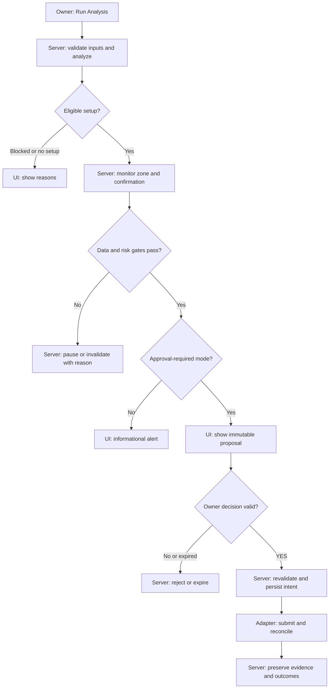

# Forex AI Trade Assistant

## Overview

Build a private TypeScript forex assistant that combines deterministic price analysis with economic news to produce conditional, expiring trade setups for one owner and one currency pair. Monitor accepted setups on the server and require authenticated approval of immutable order terms before submitting an entry. Start with analysis and paper trading; broker-demo execution, live execution and learned models have separate evidence and approval gates.

`FOREX_AI_PRD.md` is the detailed product source. The product flow below is planned; the current application implements the foundation described under Features and Module map. Proposed trading defaults remain proposals under PRD section 2.2.

## Goals

1. Explain a conditional setup with its evidence, expiry, confirmation rule, stop, target and eligibility.
2. Preserve owner control over each entry and its exact approved terms.
3. Prevent duplicate, stale or unauthorized execution across retries and restarts.
4. Keep analysis, paper, broker-demo, live and shadow outcomes distinguishable.
5. Introduce model changes only after reproducible evaluation and owner approval.

## Users and callers

- **Owner-trader (planned):** the authenticated owner reviews analyses, controls monitoring and approves or rejects entry proposals for the owned account.
- **Operator/researcher (planned):** the same owner reviews incidents, journal evidence, configuration and strategy/model promotion.
- **Web client:** the implemented browser app checks API liveness; product account access is planned.
- **Background workers (planned):** monitor setups, process approved work and reconcile outcomes within server-enforced account boundaries.

## Domain vocabulary

- **Analysis run:** a versioned evaluation of a frozen input snapshot; its product result is SETUPS, NO_TRADE or BLOCKED.
- **Setup:** a conditional opportunity with price boundaries, confirmation, invalidation and expiry.
- **Approval:** an authenticated, expiring decision bound to one immutable proposal.
- **Order intent:** the durable record authorizing one submission and tracking its reconciliation.
- **Position:** the exposure and protective exits established from authoritative fills.
- **Outcome label:** a reproducible research result that identifies its simulation and labeling policy.

## Core flow

1. The owner selects Run Analysis; the server snapshots eligible prices, closed candles, calendar and news.
2. Analysis returns setups, no qualifying opportunity or a blocked result, with input freshness and reasons.
3. The server monitors valid setups and checks observed zone entry plus the configured confirmation.
4. Passing risk and data gates produce an immutable approval proposal; rejected, expired or invalidated proposals submit no entry.
5. An authenticated YES authorizes the displayed terms. The server revalidates, consumes approval, reserves exposure and persists the intent before submission.
6. The paper adapter, then a qualified demo adapter in a later release, submits and reconciles the approved entry and protective exits.
7. The journal records evidence and separate actual, simulated and shadow outcomes.

## Workflow

Planned product workflow:

## Features

### Implemented foundation

- npm workspace with a NestJS API and React/Vite frontend.
- Stateless API liveness endpoint with an OpenAPI contract and HTTP integration tests.
- Frontend connection status, bounded request timeout and manual retry.

### Planned product capabilities

- Authenticated account access, environment separation and operator controls (FR-01, FR-11).
- Price/candle ingestion, charts, economic calendar and bounded news interpretation (FR-02, FR-03).
- Reproducible analysis, conditional setups, server monitoring and confirmation (FR-04 through FR-06).
- Immutable approvals, paper execution, reconciliation and authorized exits (FR-07 through FR-09).
- Evidence journal, reproducible outcomes and separate research evaluation (FR-10; PRD section 10).

## Module map

### API

- `@trading/api` (`apps/api`): application bootstrap and HTTP boundary; owns application configuration and module wiring, with no persistent records.
- `HealthModule` (`apps/api/src/health`): public process-liveness response; owns no account or market data.
- API configuration (`apps/api/src/config` and `apps/api/src/configure-app.ts`): validated port, configured browser origin and API prefix.

### Web

- `@trading/web` (`apps/web`): browser application and Vite proxy configuration; owns presentation and transient connection-check state.
- `App` (`apps/web/src/App.tsx`): requests liveness, displays connection status and handles retry/cancellation.

## Scope

### In scope

- TypeScript application foundation and the staged, single-pair product defined by the PRD.
- Analysis-only and approval-required paper trading before qualified broker-demo execution.
- Server monitoring, immutable evidence and explicit release gates.

### Out of scope

- Unsupervised entry, multi-pair portfolios, public signal subscriptions and managing other people's money.
- Live enablement from a browser setting, automatic model promotion and invented confidence percentages.
- Profitability claims or treating a passing software test as evidence of trading advantage.

## Success criteria

1. Every setup exposes its conditions, evidence, expiry and reasons for eligibility or blocking.
2. Every approval-required entry matches one valid owner approval and its immutable terms.
3. Duplicate events, retries and ambiguous responses cannot create an unauthorized second entry.
4. Stale or incomplete required inputs block executable output and produce an observable reason.
5. Journal and performance views preserve environment and actual/simulated/shadow distinctions.
6. Feature completion traces to the applicable PRD functional requirements and acceptance tests.

## Open product decisions

Use PRD section 14 for unresolved provider access, data rights/budget, strategy experiment settings, numeric evidence thresholds and live risk settings. The development pair, timeframes, timing windows, simulated limits and Telegram preference in section 2.2 are not approved live settings. The existing foundation does not complete PRD delivery phase 0.
