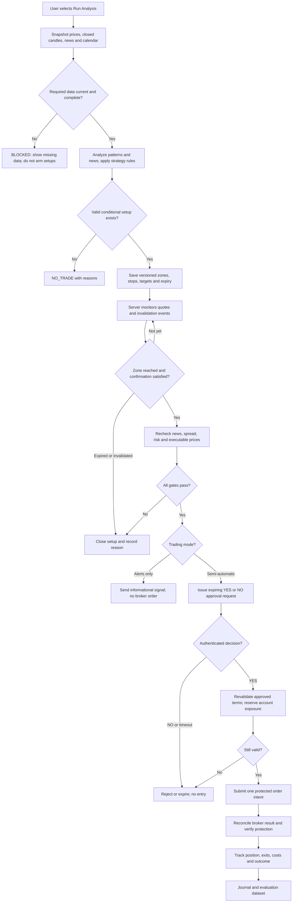
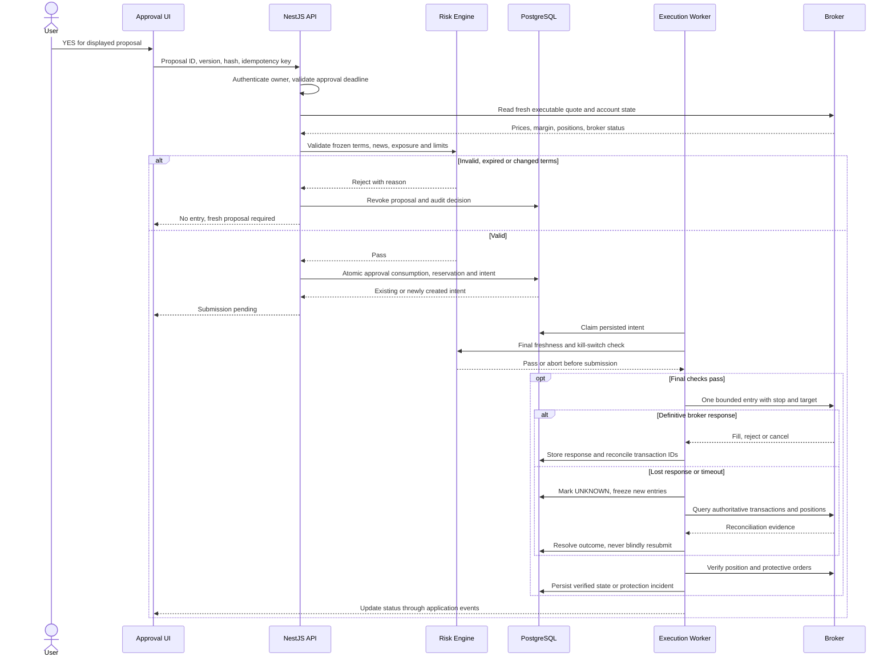
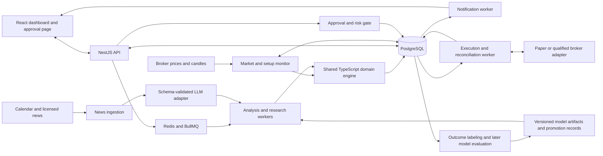
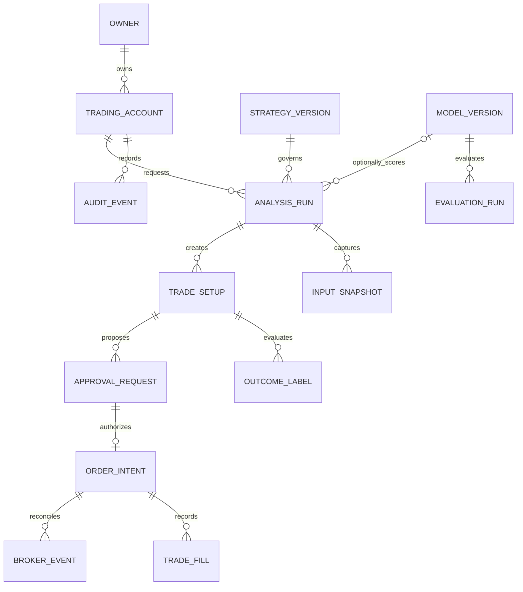
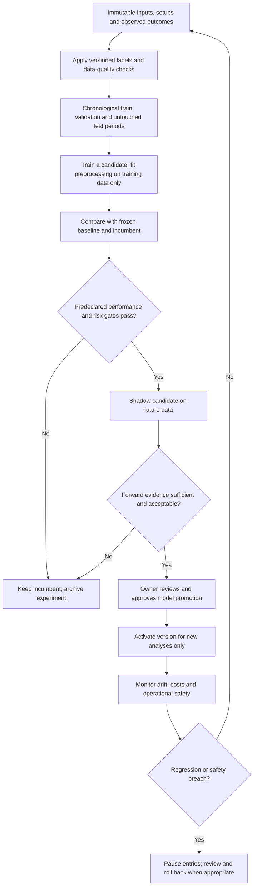

# Forex AI Trade Assistant
## Product Requirements Document · v1.0

**Prepared:** October 18, 2026  
**Owner:** Product owner / developer  
**Status:** Ready to begin demo-first implementation; not approval to trade live funds  
**Primary deliverable:** A single-pair, TypeScript-based trade analysis and human-approved execution application  
**Document basis:** The product discussion in this conversation. Proposed defaults below are recommendations, not previously confirmed decisions.

> **Product promise:** “I run an analysis. The application studies price patterns and relevant news, identifies where a BUY or SELL opportunity could occur, watches those areas, and asks for my YES or NO before submitting a trade.”

---

## 1. Executive summary

Build a private forex assistant that turns market analysis into conditional, time-limited trade setups—not unconditional predictions. The user starts an analysis manually. The system combines numerical price analysis with timestamped economic releases and news, proposes entry zones with a planned 1:3 risk-to-reward ratio, and monitors them on the server. A zone touch triggers revalidation and a defined confirmation rule. A valid opportunity generates an approval request; only an authenticated, unexpired YES can authorize its exact order terms.

The first release must support analysis-only and simulated semi-automatic trading. Broker-demo execution follows adapter validation. Live execution is a separately gated release. Collect reproducible inputs and outcomes from day one, but introduce learned probability estimates only after chronological evaluation and forward testing.

**Success has two independent meanings:** software correctness and a demonstrable trading advantage. A working application does not establish profitability. AI terminology, a plausible explanation, or a 1:3 target cannot substitute for measured results. The CFTC specifically cautions against guaranteed-return and unusually high-win-rate AI-bot claims.[S1]

## 2. Decisions, defaults, and scope

### 2.1 Requirements established in our discussion

| Decision | Requirement |
|---|---|
| Instrument scope | Exactly one forex currency pair in the first version. |
| Analysis inputs | Technical price patterns plus economic news and releases affecting both currencies. |
| User interaction | A **Run Analysis** action creates conditional BUY/SELL areas. |
| Monitoring | Monitor accepted setups automatically after the analysis finishes. |
| Entry behavior | Reaching an area triggers a validity/confirmation check, not an unconditional trade. |
| Risk/reward | Plan trades around 1 unit of price risk for 3 units of price reward. |
| Execution | Offer YES/NO approval before the application submits an entry order. |
| Technology | TypeScript for the application and initial prediction/decision engine. Python is not required. |
| Improvement | Record outcomes and evaluate model improvements; do not assume learning happens automatically. |

### 2.2 Proposed implementation defaults

These defaults allow development to start without inventing user-approved trading parameters. Version them in configuration and review them before any live release.

| Item | Proposed default | Status |
|---|---|---|
| Pair | EUR/USD | Recommended in the discussion; adopted as the PRD's development default. |
| Audience | One authenticated owner; one dedicated trading account | Proposed simplification. |
| Trading horizon | Intraday; H4/H1 context and M15 confirmation | Research assumption, not a proven optimal combination. |
| Setup lifetime | Four hours from analysis completion | Demo parameter; expires earlier on invalidation or session cutoff. |
| Maximum holding time | Eight hours from fill, or configured session close, whichever occurs first | Demo parameter; the exit policy is shown during approval. |
| Approval validity | 60 seconds, subject to earlier invalidation | Engineering starting point. |
| Scheduled-news exclusion | No new entries from 30 minutes before to 30 minutes after designated high-impact EUR/USD events | Research starting point; not a claim that the remaining period is safe. |
| Exposure | At most one open position or unresolved entry intent | Account-wide, including positions discovered at the broker. |
| Simulated risk budget | 0.25% of current equity per trade; pause new entries at a 1% daily equity loss | Demo-only defaults, not personalized live-risk advice. |
| Reporting | Asia/Manila display and risk-day boundary; UTC storage | Session calendars must account for their own time zones and daylight saving. |
| Notifications | In-app plus a Telegram notification linking to the authenticated approval page | No trade approval from an unauthenticated message or URL. |

### 2.3 Release scope

| Included in the initial product | Deferred or excluded |
|---|---|
| EUR/USD chart, broker-quality prices, news/calendar panel | Multiple pairs, crypto, gold, portfolio optimization |
| On-demand analysis with explicit NO_TRADE/BLOCKED results | High-frequency trading or latency-sensitive news-release trading |
| Versioned zones, expiry, confirmation, alerts, YES/NO workflow | Unsupervised live entries |
| Deterministic baseline and LLM-assisted news interpretation | Reinforcement learning, self-modifying strategies, automatic retraining after each trade |
| Paper execution, journal, replay/backtesting, safety controls | Martingale, grids, averaging down, pyramiding, hedged simultaneous positions |
| Demo broker adapter after capability checks | Public signal subscriptions, copy trading, management of other people's money |
| Outcome collection and later supervised model evaluation | Profit guarantees, marketed win-rate targets, screenshot-only decision making |

Execution mode and environment are separate settings: `ALERTS_ONLY` or `APPROVAL_REQUIRED`, combined with `PAPER`, `BROKER_DEMO`, or gated `LIVE`. “Analysis-only” in this document means alerts-only with no broker entry submission. Fully automatic entry is not a v1 mode.

A native mobile app, vector database, agent framework, TimescaleDB extension, and separate Python service are **not MVP dependencies**.

## 3. Users, goals, and success measures

The primary user is the owner-trader, who needs understandable setups and control over entry decisions. The same person acts as operator/researcher, reviewing failures, broker reconciliation, and strategy versions. Keep these permissions conceptually distinct even within a single-owner deployment.

| Goal | Acceptance measure |
|---|---|
| Know when and where an opportunity may develop | Every valid setup has a bounded zone, direction, explanation, expiry, confirmation rule, stop, and preliminary target. |
| Retain execution control | Zero entry submissions without a matching valid approval in semi-automatic mode. |
| Avoid duplicate or stale trades | Retry, concurrent-approval, stale-quote, and crash-recovery tests produce no unauthorized duplicate position. |
| Understand the evidence | Every approval and trade links to its original inputs, strategy version, news sources, and gate decisions. |
| Evaluate financial performance honestly | Separate backtest, shadow, paper, broker-demo, and live results; report costs, exposure, uncertainty, and drawdown. |
| Improve selectively | A candidate replaces the incumbent only after a documented evaluation and owner approval. |

No minimum win rate or return is promised. Define research promotion thresholds before evaluating the reserved test period; insufficient evidence means continued research, not relaxed thresholds.

## 4. End-to-end product journey

### 4.1 Main flow



Monitoring continues while the browser is closed, provided the server and required providers remain healthy. Running a fresh analysis creates a new snapshot; it must never silently edit an existing approved order or open position.

### 4.2 Setup lifecycle

```mermaid
stateDiagram-v2
    [*] --> WATCHING: Valid setup armed
    WATCHING --> AWAITING_CONFIRMATION: Executable quote enters zone
    AWAITING_CONFIRMATION --> WATCHING: Trigger not confirmed; setup still valid
    AWAITING_CONFIRMATION --> ALERTED: Confirmed in alerts-only mode
    AWAITING_CONFIRMATION --> AWAITING_APPROVAL: Confirmed in semi-automatic mode
    AWAITING_APPROVAL --> REJECTED: User selects NO
    AWAITING_APPROVAL --> EXPIRED: Approval deadline passes
    AWAITING_APPROVAL --> INVALIDATED: Terms or market gates fail
    AWAITING_APPROVAL --> EXECUTION_PENDING: YES and final checks pass
    EXECUTION_PENDING --> CONSUMED: Fill reconciled
    EXECUTION_PENDING --> INVALIDATED: Definitive broker rejection or cancellation
    WATCHING --> PAUSED: Required feed unhealthy
    AWAITING_CONFIRMATION --> PAUSED: Required feed unhealthy
    PAUSED --> WATCHING: Revalidated with fresh data
    PAUSED --> EXPIRED: Setup deadline passes
    WATCHING --> INVALIDATED: Structural or news invalidation
    AWAITING_CONFIRMATION --> INVALIDATED: Structural or news invalidation
    WATCHING --> EXPIRED: Setup deadline passes
    AWAITING_CONFIRMATION --> EXPIRED: Setup deadline passes
    ALERTED --> [*]
    REJECTED --> [*]
    EXPIRED --> [*]
    INVALIDATED --> [*]
    CONSUMED --> [*]
```



An ambiguous broker response leaves the setup **EXECUTION_PENDING**, with its order intent **UNKNOWN** and new account entries blocked. It is not a rejection and must not cause an automatic resubmission. Temporary data failure revokes outstanding approvals; recovery does not resurrect them. Setup, approval, order, and position states are separate records.

## 5. Functional requirements

### FR-01 — Account, environment, and mode

Require authenticated ownership for every account, setup, approval, and journal read/write. Display the active environment prominently: **PAPER**, **BROKER DEMO**, or **LIVE**. Default to PAPER. Switching environments invalidates pending approvals and cannot migrate them to another account. Live mode must not be activatable by a frontend setting alone.

**Acceptance:** A PAPER approval cannot reach a live adapter; an unauthorized account identifier returns an authorization error; mode changes preserve existing broker protection and audit history.

### FR-02 — Market ingestion and chart

Ingest timestamped bid/ask prices, instrument precision and unit constraints, completed candles, market-open status, and feed health. Use the execution broker's feed where feasible; expose provider differences when research data comes from elsewhere. Store provider timestamp and application receipt timestamp separately. Deduplicate, reject out-of-order updates for current-state decisions, detect gaps, and backfill completed candles after reconnection.

The chart displays provider, quote age, spread, selected timeframe, zone overlays, stop/target, and pending economic events. Numerical data—not a chart screenshot—is authoritative. An illustrative rendering must never appear as a live broker quote.

**Acceptance:** Missing candles or stale execution quotes block new entries; a weekend/out-of-session analysis may show historical context but cannot arm an executable setup. A chart midpoint touching a BUY zone does not qualify unless the configured executable ask also qualifies.

### FR-03 — Economic calendar and news

Monitor releases and credible news affecting EUR and USD, including central-bank decisions, inflation, and employment. Separate scheduled time, actual publication time, provider receipt time, original actual/consensus values, revisions, and article updates. Normalize units before calculating surprise features; preserve missing forecasts as unknown.

Use structured calendar data for release facts and an LLM for bounded extraction and explanation. Trading Economics documents a calendar and release stream, but coverage, historical vintages, latency, licensing, and subscription access must be checked for the selected plan.[S2]

Treat article text as untrusted input. It cannot instruct the system to change risk settings, call tools, access secrets, or submit orders. The LLM receives approved source excerpts and identifiers, not broker credentials or account-sensitive data. Unknown or conflicting evidence must remain visible rather than being converted into invented sentiment.

**Acceptance:** News summaries reference real source IDs; invalid JSON, absent required calendar coverage, or a materially stale news feed blocks tradable output. Revisions do not overwrite what was available to an earlier analysis.

### FR-04 — Run Analysis

The user triggers a server-side analysis job. The UI shows QUEUED, RUNNING, COMPLETE, BLOCKED, or FAILED and allows inspection of failure reasons. Snapshot the data cutoff, strategy/configuration version, prompt/model version, and account-independent technical inputs. Concurrent identical clicks reuse the active job rather than creating duplicate setups.

Return one of: **SETUPS**, **NO_TRADE**, or **BLOCKED**. NO_TRADE means valid inputs but no qualifying opportunity; BLOCKED means safe evaluation or execution is unavailable. Produce at most one primary and one mutually exclusive alternative scenario. The default run arms valid setups in the selected mode; arming is not permission to execute.

**Acceptance:** Identical stored inputs and deterministic configuration reproduce the same technical decisions. Completion includes input freshness and reasons, even when no trade is proposed.

### FR-05 — Conditional setups and evidence

Each setup contains direction, bounded entry zone, structural invalidation, stop, preliminary target, confirmation rule, expiry, holding-time policy, and source-linked explanation. Separate technical observations from news interpretation and unverified hypotheses.

A rules score may be displayed as **setup quality**, never as a success probability. A win-probability field remains null until an independently evaluated, calibrated model exists. Do not ask an LLM to invent a numeric trading confidence percentage.

**Acceptance:** Replacing an unfilled setup creates a new version and revokes the old approval; it cannot silently change any filled trade. BUY and SELL alternatives share an exclusion group, and the account reservation allows at most one to proceed.

### FR-06 — Zone monitoring and confirmation

Evaluate live quotes against armed zones. Require an observed zone entry and the configured closed-candle confirmation; a quote gap across the entire zone is not a trade at the skipped price. Recheck structural validity, news exclusion, spread, feed freshness, exposure, and target feasibility before requesting approval.

Emit an optional **zone reached** informational event separately from **trade approval required**. Deduplicate notifications by setup version and event type. Paused monitors resume only after reconciliation and fresh validation; they do not replay missed signals as executable opportunities.

**Acceptance:** A zone touch alone creates no order; duplicate price events create no duplicate approval; a subsequently invalidated setup never sends a fresh BUY/SELL approval.

### FR-07 — Approval experience

Show pair, BUY/SELL, account/environment, current bid/ask, allowed fill-price interval, units, maximum planned cash risk and equity percentage, stop, target, estimated costs, expiry countdown, rationale, and exit policy. Present clearly labeled **YES — Submit this trade** and **NO — Reject** actions with neither selected by default.

YES authorizes the displayed, hashed order proposal only. Bind approval to owner, account, setup version, units, direction, fill limits, stop, target, cost/risk bounds, expiry, and exit policy. Any material change requires a new proposal and fresh approval. No response, a late response, or a replayed response is never consent.

**Acceptance:** Repeated YES clicks return the same intent; YES after NO cannot reopen it; a notification link only opens the authenticated page and never executes a GET-triggered trade.

### FR-08 — Execution and reconciliation

After approval, revalidate with a fresh executable quote and account snapshot, atomically consume the approval, and reserve exposure before the network submission. Persist an order intent and audit/outbox event. Submit through a broker adapter that enforces supported price bounds and server-managed protection.

Record order IDs, transaction IDs, fills, fees, cancellations, rejections, and protective orders. A request timeout is **UNKNOWN**, not FAILED. Query authoritative broker state and reconcile before considering any retry. Local uniqueness alone does not make broker execution exactly-once. Queue workers must tolerate reprocessing, consistent with BullMQ's idempotent-job guidance.[S3]

**Acceptance:** Crash-after-submit and lost-response tests cannot create a second entry. A partially filled or externally modified position is recorded accurately and blocks new exposure; do not automatically top up partial fills.

### FR-09 — Position management and exits

Entry approval also authorizes the displayed stop-loss, take-profit, maximum-holding-time exit, and defined emergency protection-failure exit. These approved exits do not require a second YES. A separate SELL entry means opening a short, not implicitly closing a long.

Verify protection after a fill. If required protection is absent or its state is unknown, freeze entries, reconcile, alert the owner, and invoke the approved emergency policy when the broker is reachable. Never promise that a stop guarantees an exact exit or a hard loss ceiling.[S7]

**Acceptance:** Server restarts do not remove broker-held stops/targets. A holding-time deadline triggers the authorized exit or, during an outage, an incident and reconciliation until resolution. SL widening, averaging down, and automatic strategy-driven exit changes are excluded from v1.

### FR-10 — Journal, outcomes, and learning records

Record every analysis and proposed setup, including NO_TRADE, rejected, expired, untriggered, and invalidated cases. Log decisions as immutable events with correlation IDs. Preserve market evidence at analysis, zone touch, confirmation, approval, submission, fill, and exit.

Maintain separate outcomes for executed trades and hypothetical/shadow setups. A user's NO is a preference decision, not a failed prediction. An untriggered setup has no fictitious entry; a timeout exit is not automatically a stop-loss. Link each evaluated outcome to its labeling and fill-simulation policy.

**Acceptance:** Reports cannot silently mix real and simulated P&L; each label can be reproduced from archived inputs or explicitly marked unresolvable.

### FR-11 — Operator controls and reporting

Provide **Pause New Entries**, **Cancel Unfilled Setups**, and **Close Position** as distinct actions. Pausing never cancels protective exits. A close-position request must show its consequence and use the same durable reconciliation rules as other broker actions.

Report win/loss/timeout counts, net expectancy in R, profit factor, realized and mark-to-market drawdown, fees, slippage, spread, exposure, approval latency, rejection reasons, feed gaps, and model/strategy versions. Include sample sizes and date ranges.

**Acceptance:** The user can explain why a trade did or did not execute, export its journal, and distinguish a model failure from a data, execution, or user-decision issue.

## 6. Reference strategy and risk calculations

### 6.1 A testable baseline, not a claim of trading advantage

Begin with one versioned **trend-aligned support/resistance rejection** strategy. The following is a proposed research configuration; the product owner may replace it before the first experiment. Avoid implementing dozens of patterns before establishing a reproducible baseline.

| Step | Initial deterministic specification |
|---|---|
| Context | Use completed H1 and H4 candles. Long bias requires the close above EMA(50) and EMA(50) above its value five bars earlier on both timeframes; short bias reverses those tests. Otherwise NO_TRADE. |
| Warm-up | Require at least 200 completed candles on each context timeframe and 100 M15 candles. Version EMA initialization and ATR(14) smoothing conventions. |
| Levels | An H1 pivot low must be strictly below the lows of the two bars on either side; a pivot high reverses the comparison. It becomes usable only after the second right-side bar closes. Search the last 100 eligible H1 bars. |
| Zone | Select the closest qualifying support below the current ask for a long, or resistance above the bid for a short, within two H1 ATR values. Freeze the zone at the level plus/minus 0.15 ATR measured at analysis. |
| Stop and invalidation | Place the long stop 0.5 ATR below the support, or the short stop 0.5 ATR above resistance. Exclude levels with a completed H1 close beyond that boundary after the pivot became known. An executable quote crossing that boundary invalidates an armed setup. |
| Confirmation | After an observed touch, require a closed M15 candle that is bullish and closes above the prior M15 high for a long; bearish and below the prior low for a short. Current executable price must still satisfy the permitted entry zone. No chasing a move outside it. |
| Target feasibility | Construct the 3R target. For a long, reject if a confirmed H1/H4 pivot high lies above the worst permitted entry and at or below the target; for a short, reverse the comparisons using pivot lows. Apply the same two-bar confirmation rule to H4 levels. Absence of an opposing level is not evidence that the target will be reached. |
| News | Scheduled exclusions are hard gates. Structured news interpretation may flag conflict or uncertainty and block a setup; the LLM cannot create a new price zone or waive a gate. |
| Entry | Request approval only after all conditions pass. Any alternative scenario remains mutually exclusive, never a hedge or automatic reversal. |

Before execution integration, write golden fixtures for every rule, including equal highs/lows, delayed pivot confirmation, flat ATR, insufficient history, gaps, and news revisions. This research configuration may produce few or no trades; do not weaken it merely to manufacture activity.

### 6.2 Meaning of 1:3

For entry price `E`, stop `S`, and target `T`:

```text
Long:  priceRisk = E - S;  T = E + 3 × priceRisk
Short: priceRisk = S - E;  T = E - 3 × priceRisk
Gross reward/risk = abs(T - E) / abs(E - S)
```

For an **illustrative**, non-live long entry of 1.08550, a stop of 1.08350 implies a target of 1.09150: 20 pips of price risk and 60 pips of price reward for EUR/USD.

An entry zone does not have one fixed reward/risk ratio. At approval time, calculate the final proposal using the **worst permitted fill price** within a bounded entry interval. Require at least 3:1 gross reward/risk throughout that interval. Freeze the displayed stop, target, unit size, and bounds after approval. If a broker cannot enforce the required entry bound, it does not qualify for this execution policy.

Reject nonpositive stop distances, nonfinite features, invalid bid/ask ordering, and zero permissible units. Use decimal arithmetic or scaled integers for prices, money, and units. Round units downward to broker increments and recompute after price rounding. Include account-currency conversion, commission, spread-aware fills, and slippage assumptions in sizing. Reject trades whose broker minimum size exceeds the configured risk budget. Do not subtract spread twice when it is already included in bid/ask entry and exit prices.

**Important:** “1:3” describes planned gross price distances. Realized results vary with fees, financing, fill prices, time exits, and stop slippage. Position sizing and daily limits are controls, not guaranteed loss caps.

### 6.3 Expectancy

When every outcome is exactly +3R or −1R, with average additional cost `c` measured in R:

```text
Expected net R per trade = 3p - (1 - p) - c = 4p - 1 - c
Break-even p = (1 + c) / 4
```

Thus 25% is the frictionless, two-outcome break-even rate—not the actual live threshold. With time exits or varying payoffs, calculate `sum(outcomeProbability × netOutcomeR)` or the sample mean of actual net R. Do not use the simplified equation as the production performance model.

## 7. Approval and execution sequence



The post-claim gate must have a persisted abort path. A failed final check cancels the unsent intent, revokes its approval, and releases exposure only after confirming nothing was submitted. If send initiation is ambiguous, retain the reservation and reconcile.

## 8. Technical architecture

### 8.1 Recommended stack

| Layer | Recommendation | Boundary |
|---|---|---|
| Web | React + Vite + TypeScript, MUI, TanStack Query, Lightweight Charts | Dashboard, explanations, journal, authenticated approval UI. |
| API | NestJS modular monolith | Ownership, REST/events, analysis orchestration, approvals and controls. |
| Domain engine | Pure TypeScript package | Indicators, deterministic patterns, zones, risk arithmetic, replay, confirmation. No NestJS dependency inside pure functions. |
| Persistence | PostgreSQL + Prisma | Durable truth, numeric values, transactions, ownership, audit and outbox. |
| Jobs | Redis + BullMQ with NestJS integration | Analysis, notifications, ingestion recovery, outcome labeling and research jobs.[S4] |
| Price monitoring | Long-running TypeScript worker | Consume provider stream directly; avoid placing every quote into the job queue. |
| News AI | Provider adapter; initially OpenAI API with schema-validated structured outputs | Bounded extraction/explanation. JavaScript schema support is documented; valid schema does not establish truthful analysis.[S5] |
| Execution | Paper adapter, then one qualified broker adapter | Normalize capabilities and responses; never assume all brokers share order semantics. |
| Later ML | TensorFlow.js in isolated workers; ONNX Runtime only for compatible model artifacts | Node-based training/inference is possible; native TensorFlow operations must not block the API or monitor.[S9][S10] |
| Runtime | Docker; continuously running API and workers with managed PostgreSQL/Redis | Start with one codebase and separate processes, not a fleet of microservices. |
| Tests | Jest, API integration tests, Playwright, deterministic replay fixtures | Risk and execution paths receive adversarial/concurrency testing. |

Use PostgreSQL first. Consider time-series extensions only after measuring an actual storage or query bottleneck. Select and pin supported library/runtime versions during dependency review rather than copying unverified version numbers from this PRD.

### 8.2 Component flow



PostgreSQL outbox records supply the notification and execution work shown above; arrows do not imply an external worker may bypass ownership, approval, or account-reservation rules. The research worker has no broker write credentials. Use a separate worker process for model training or large replay jobs.

### 8.3 Broker and data decision

OANDA is a **candidate adapter**, not a finalized broker choice or assertion of eligibility in the Philippines. Its documentation describes separate practice/live environments and order fields for price bounds and attached stop-loss/take-profit instructions.[S6][S7] Confirm the actual legal entity, account access, product, market-data rights, and execution features before selecting it.

Do not hard-code “WebSocket” into the broker contract: OANDA's documented pricing stream is HTTP streaming and may deliver at most four prices per second per instrument rather than every price.[S8] The application must reason from observed events, identify coverage limits, and avoid promises of detecting every transient touch.

The adapter contract must cover candles/quotes, account/instrument metadata, protected bounded entry, position close, protective-order inspection, transaction reconciliation, and health. Demo-gate evidence must include spread behavior, minimum distance/size rules, account currency, order IDs, partial-fill policy, disconnects, and ambiguous results.

## 9. Data model and API contract

### 9.1 Core entities



| Entity group | Required information |
|---|---|
| Market records | Provider/instrument, bid/ask, UTC event/receipt times, candle timeframe and completeness, precision, gap markers, data version. |
| News/event snapshots | Source IDs, original text/excerpt where licensed, content hash, publication/receipt/revision times, original actual/consensus, units, impact classification. |
| Analysis and setup | Data cutoff, parameter/strategy/prompt/model versions, feature snapshot, reasons, price boundaries, confirmation state, expiry, exclusion group. |
| Approval | Owner/account, proposal version/hash, immutable price and risk terms, deadline, decision, authentication/audit metadata. |
| Execution | Unique approval-to-intent relation, account reservation, submission state, request/response evidence, broker transaction IDs, fills, protection and position state. |
| Research | Label policy, entry simulation rule, costs, barrier/time outcomes, uncertain data flags, dataset hashes, split boundaries, evaluation and promotion records. |

Use database constraints and compare-and-set transitions to enforce ownership, unique broker-event ingestion, one consumed approval, and one reserved exposure slot per account. Keep monetary fields as numeric/decimal values; transmit them as decimal strings. Redis is not the source of truth for approvals or order state.

### 9.2 Representative endpoints

| Method and path | Behavior |
|---|---|
| `POST /analyses` | Enqueue a deduplicated analysis; return its ID with HTTP 202. |
| `GET /analyses/:id` | Retrieve progress, input freshness, results and reasons. |
| `GET /setups` | List current or historical setups by state and environment. |
| `POST /setups/:id/cancel` | Cancel an unfilled setup and revoke pending approval. |
| `GET /approvals/:id` | Return the current immutable proposal and eligibility. |
| `POST /approvals/:id/decision` | YES/NO plus expected version, hash and idempotency key. |
| `GET /orders/:id` | Retrieve submission and authoritative reconciliation status. |
| `POST /positions/:id/close` | Explicitly request a reconciled manual exit. |
| `POST /controls/pause-entries` | Pause new entries without altering protective exits. |
| `GET /journal` and `GET /performance` | Filter/export evidence and clearly separated result classes. |

Return structured reason codes, including `STALE_QUOTE`, `NEWS_BLOCK`, `APPROVAL_EXPIRED`, `TERMS_CHANGED`, `EXPOSURE_RESERVED`, `RISK_LIMIT`, `BROKER_UNKNOWN`, and `PROTECTION_UNVERIFIED`. Publish versioned setup/approval/order events to the UI through SSE or WebSocket, with reconnect-and-resync behavior.

## 10. AI improvement and research controls

### 10.1 Learning objective

Eventually estimate whether an **eligible, precisely defined entry** reaches its profit barrier before its stop within the holding horizon. Keep probabilities for target-first, stop-first, and time-exit outcomes distinct, and evaluate the resulting net expectancy. Analyze user-approved execution results separately from the strategy's shadow results, because approval delay changes entry conditions.

Start with the deterministic baseline, then compare a simple supervised model against it. TensorFlow.js is an available TypeScript-compatible route, but adopting a model is conditional on evidence—not a release checklist item. A model that never improves the baseline should never be promoted.

### 10.2 Learning flow



### 10.3 Validation requirements

Use chronological walk-forward evaluation, not random shuffling. Time-ordered evaluation avoids the obvious error of training on future observations and testing on the past.[S11] Because setup outcomes span intervals and occur irregularly, explicitly purge training labels overlapping validation/test windows and choose a gap from the holding horizon. A generic time-series splitter alone is not sufficient.

Freeze feature transformations, hyperparameters, probability calibration, and trading thresholds before the untouched test. Keep an experiment ledger so repeatedly searching strategies cannot turn the test set into another training set. Report calibration curves and Brier/log-loss diagnostics alongside economics; a model score is not automatically a calibrated probability.[S12]

Historical news must be point-in-time. Reconstructed articles or LLM summaries produced today can introduce hindsight, including knowledge embedded in the model. Without credible original release/consensus vintages and evidence of historical availability, limit historical testing to supported features and validate LLM news additions prospectively.

For simulated fills, buy at ask and sell at bid; reverse the side on exit. Model spread, latency, commissions, slippage, and financing where applicable. Replay approval delay for semi-automatic scenarios. If a coarse candle touches both barriers and event ordering is unknowable, mark the result ambiguous or apply a predeclared conservative convention—never assume the target came first.

Maintain separate records for untriggered, invalidated, expired, user-rejected, time-exited, stop-hit, and target-hit cases. Evaluate eligible rejected signals in a labeled shadow simulation, not as actual trades. Aggregate dependent samples carefully and report uncertainty; hundreds of highly overlapping setups are not hundreds of independent observations.

Retraining may be scheduled for consideration, but requires adequate new representative data. Promotion needs positive net expectancy on reserved and forward data, improvement over the incumbent under the chosen metric, acceptable drawdown, stability across periods, and owner signoff. Configure numeric evidence thresholds before evaluation; no arbitrary trade count establishes profitability.

## 11. Reliability, security, and operational requirements

The following are initial engineering targets, not promises about provider availability or network delivery.

| Area | Requirement / initial target |
|---|---|
| Latency | Analysis-job acknowledgement p95 under one second; observed qualifying event to in-app alert p95 under two seconds. Exclude provider latency and time spent waiting for candle confirmation. Measure full analysis and broker latency separately. |
| Freshness | Execution quote age at most three seconds at final validation; fetch a fresh quote when necessary. Calendar/news have explicit provider-specific health and coverage checks. No “latest available” fallback that silently bypasses them. |
| Availability | Target 99.5% monitored availability during configured market hours in the demo environment; outages pause entries and generate health alerts. |
| Durability | An acknowledged approval/intent must be durably committed before broker submission. Use managed durability, tested backups and recovery. Block entries until broker reconciliation completes after restore. |
| Restart safety | Reload active setups, invalidate stale approvals, reconcile unknown intents/open positions, verify protection, then resume monitoring. |
| Security | TLS, secure authenticated sessions, server-side authorization, CSRF protection where applicable, rate limiting, secret storage and redaction. Never expose broker keys to the browser, LLM, or research worker. |
| Live controls | Step-up authentication for live enablement and increased limits. Separate live credentials/configuration; record operator approval. |
| AI controls | Version prompts/models; validate schemas and source references; cap call volume and payloads. A malformed or unavailable AI response cannot authorize a trade. |
| Observability | Correlation IDs across analysis, setup, approval and broker events; metrics for feed lag, queue lag, approvals, retries, unknown orders, protection gaps and daily risk. |
| Risk-day handling | Daily baseline is equity at 00:00 Asia/Manila, adjusted for deposits/withdrawals. Include realized and unrealized losses; crossing the limit pauses entries, not existing protective exits. |
| Cost controls | Track market-data, news, LLM, hosting and storage costs separately. Cache analysis-compatible news results; do not invoke an LLM for every tick. |
| Retention | Never purge evidence for an active or unresolved trade. Preserve decision snapshots and journal history; configure raw-feed retention/archiving only after replay needs and licensing are established. |

Changes to risk rules or news coverage must be versioned and revoke incompatible pending approvals. After a pause, daily reset, deployment, or recovery, require fresh eligibility checks; none of those events imply permission to trade.

## 12. Acceptance test matrix

| ID | Scenario | Required result |
|---|---|---|
| AT-01 | Valid data but no qualifying pattern | NO_TRADE, explanation, no armed order. |
| AT-02 | Stale quotes, missing candle history, or unavailable required calendar | BLOCKED/PAUSED; no execution or invented news. |
| AT-03 | Quote enters zone without confirmation | Informational event only; no approval or order. |
| AT-04 | Valid confirmation and gates | One approval with fixed terms, costs and expiry. |
| AT-05 | NO, no response, expired approval, or wrong owner | No entry submission. |
| AT-06 | Repeated/concurrent YES requests or queue redelivery | At most one actionable intent and no duplicate broker entry. |
| AT-07 | Price leaves bounds or risk/news changes before send | Abort; require new approval for changed terms. |
| AT-08 | Broker accepts order but response is lost | UNKNOWN, exposure retained, reconcile; no blind retry. |
| AT-09 | Crash before/after submission or database restore | Reconcile broker truth before resuming. |
| AT-10 | Partial fill or missing protective order | Accurate state, entry freeze, alert and authorized emergency handling. |
| AT-11 | Two opposing setups trigger concurrently | One account reservation; other approval invalidated/blocked. |
| AT-12 | Malicious news text requests a trade or reveals secrets | Treated as data; no tool execution or privilege change. |
| AT-13 | Future candle, revised release, or overlapping training label | Leakage fixture fails validation; no promotion. |
| AT-14 | Both price barriers occur in one unresolved candle | Ambiguous/conservative labeled result, not an invented win. |
| AT-15 | Browser closed, notification delayed, stream reconnected | Server policy continues; missed/expired approvals do not execute later. |
| AT-16 | Kill switch, external position, or daily loss limit | New entries blocked; existing protection retained and reconciled. |
| AT-17 | Same zone, different fill prices and rounding | Position sizing and gross/net reward-risk recomputed correctly. |
| AT-18 | Candidate beats training data but fails reserved/forward data | Incumbent retained; experiment recorded. |

Release evidence includes unit fixtures, adapter contract tests, API/database integration tests, replay/backtest checks, and Playwright coverage of approval, rejection, expiry and recovery UI.

## 13. Delivery plan and release gates

| Phase | Work / requirement mapping | Exit gate |
|---|---|---|
| 0 — Foundation and provider validation | Confirm demo provider capabilities, source licensing, strategy assumptions; scaffold TypeScript domain package, schemas, account/mode isolation and test fixtures. FR-01/02. | Mock/replay and one real data source can run; unresolved broker/legal matters recorded, not assumed solved. |
| 1 — Analysis and observation | Candles, chart, news/calendar, Run Analysis, deterministic zones, source-linked explanations, monitoring and informational alerts. FR-02–06. | Historical/replayed and forward observations are reproducible; no broker entry code enabled. |
| 2 — Complete paper MVP | YES/NO, immutable proposals, sizing, paper fills/exits, kill switch, journal, outcome labels and backtesting. FR-07–11. | Applicable acceptance tests pass; every simulated trade has complete approval and outcome evidence. |
| 3 — Broker-demo integration | Qualified adapter, protected bounded entry, authoritative fills, unknown-order reconciliation, restart/outage drills. FR-08/09. | All execution tests pass against demo behavior; position and protection are independently verifiable. |
| 4 — Predictive model research | Train/evaluate optional supervised scorer; compare technical-only versus news-assisted variants and incumbent; shadow future data. Section 10. | Predeclared evidence gates pass or model remains undeployed. This phase need not end in promotion. |
| 5 — Restricted live pilot | Eligibility/legal review, risk settings, cost assumptions, incident procedures, secured credentials, forward-performance review and explicit owner authorization. | Independent engineering and strategy gates both pass; live feature flag enabled only by recorded approval. |

A validated deterministic strategy can be considered separately from an ML-enhanced strategy. Live deployment does not require adding a neural network, and adding a neural network does not justify live deployment.

**Recommended first vertical slice:** Feed replay → one deterministic setup → zone/confirmation → YES/NO → paper order with exits → journal. Add the real news provider before calling the analysis product-complete; add live broker permissions only after the paper and demo paths are reliable.

## 14. Open decisions and principal risks

| Decision / risk | Recommendation and timing |
|---|---|
| Broker access and jurisdiction | Choose the actual broker entity/account only after verifying eligibility, API permissions, automation terms and applicable requirements. Blocks broker/live execution, not domain/UI work. |
| Pair and timeframe | Use EUR/USD and H4/H1/M15 as development defaults; confirm before freezing the first strategy experiment. |
| Exact strategy and evidence thresholds | Freeze the reference rules, trading session, costs, data split, drawdown tolerance and promotion thresholds before performance evaluation. |
| Data/news budget | Confirm calendar, original consensus/release history, streaming delay and storage rights. Do not infer historical completeness from a live endpoint. |
| Notification preference | Begin with in-app plus Telegram deep link; all approvals stay inside the authenticated application. |
| Live risk amount | Require explicit owner-set equity risk, daily limit, position bounds, slippage/spread tolerances and emergency policy before live enablement. Demo defaults do not silently become live defaults. |
| False confidence or overfitting | Keep rules scores separate from calibrated probabilities; reserve future data and compare with a simple baseline. |
| Market change or weak performance | Allow NO_TRADE and prolonged inactivity; pause or retain the incumbent rather than forcing opportunities. |
| Loss of connectivity / broker uncertainty | Fail closed for entries, preserve protection, reconcile, and expose unresolved risk clearly. |
| Historical LLM hindsight | Use genuine point-in-time features where supported and forward-only validation for unsupported historical news inference. |
| Product expansion | Keep private/single-owner scope. A public advisory or execution product requires a new legal, security and product review. |

## 15. Implementation handoff rules

The implementation should preserve the product boundary: **the LLM interprets news, deterministic code enforces trading/risk/approval rules, and only the authorized broker adapter submits orders.** Keep these boundaries testable even within one repository.

Use a small workspace such as `apps/web`, `apps/api`, `apps/worker`, `packages/domain`, and `packages/contracts`. Keep backtest and runtime strategy logic shared so fixes cannot silently diverge. Introduce no additional infrastructure without a measured need.

Before marking any epic complete, map it to the relevant FR and acceptance-test IDs; run targeted tests, then integration/E2E tests covering changed behavior. Attach commands/results, unresolved limitations, migration effects, and rollback notes. Do not label a stubbed broker/news integration as complete or generate placeholder “AI confidence” values for production UI.

**Readiness conclusion:** Begin implementation of the demo-first product now. Treat broker selection, real-data validation, strategy evidence, and live-funds authorization as explicit gates—not assumptions hidden inside implementation tasks.

---

## References and verification notes

Official documentation reviewed October 18, 2026. These sources verify integration capabilities and methodological cautions; they do not validate this proposed strategy, numerical defaults, broker eligibility, or future profitability. The scikit-learn references describe evaluation concepts, not a requirement to use Python.

| Ref | Source and relevance |
|---|---|
| S1 | [CFTC — AI Won’t Turn Trading Bots into Money Machines](https://www.cftc.gov/LearnAndProtect/AdvisoriesAndArticles/AITradingBots.html). Risk of unsupported AI trading-performance claims. |
| S2 | [Trading Economics — Economic Calendar](https://docs.tradingeconomics.com/economic_calendar/) and [Calendar Streaming](https://docs.tradingeconomics.com/economic_calendar/streaming/). Calendar/release interfaces; validate plan-specific entitlements. |
| S3 | [BullMQ — Idempotent jobs](https://docs.bullmq.io/patterns/idempotent-jobs). Retry-safe job design; not a broker exactly-once guarantee. |
| S4 | [NestJS — Queues](https://docs.nestjs.com/techniques/queues). Redis-backed BullMQ integration. |
| S5 | [OpenAI — Structured model outputs](https://developers.openai.com/api/docs/guides/structured-outputs). JavaScript/schema-based structured responses and limitations. |
| S6 | [OANDA — Development Guide](https://developer.oanda.com/rest-live-v20/development-guide/). Practice/live environment and integration details. |
| S7 | [OANDA — Order Definitions](https://developer.oanda.com/rest-live-v20/order-df/). Price bounds, on-fill protection, and ordinary stop-order behavior. |
| S8 | [OANDA — Pricing endpoint](https://developer.oanda.com/rest-live-v20/pricing-ep/). HTTP pricing stream and sampling limitations. |
| S9 | [TensorFlow.js — Node.js guide](https://www.tensorflow.org/js/guide/nodejs). Node execution and worker/thread isolation considerations. |
| S10 | [ONNX Runtime — Node.js binding](https://onnxruntime.ai/docs/get-started/with-javascript/node.html). Optional inference with compatible exported models. |
| S11 | [scikit-learn — TimeSeriesSplit](https://scikit-learn.org/stable/modules/generated/sklearn.model_selection.TimeSeriesSplit.html). Time-ordered validation and its assumptions. |
| S12 | [scikit-learn — Probability calibration](https://scikit-learn.org/stable/modules/calibration.html). Reliability of probability estimates and calibration evaluation. |
